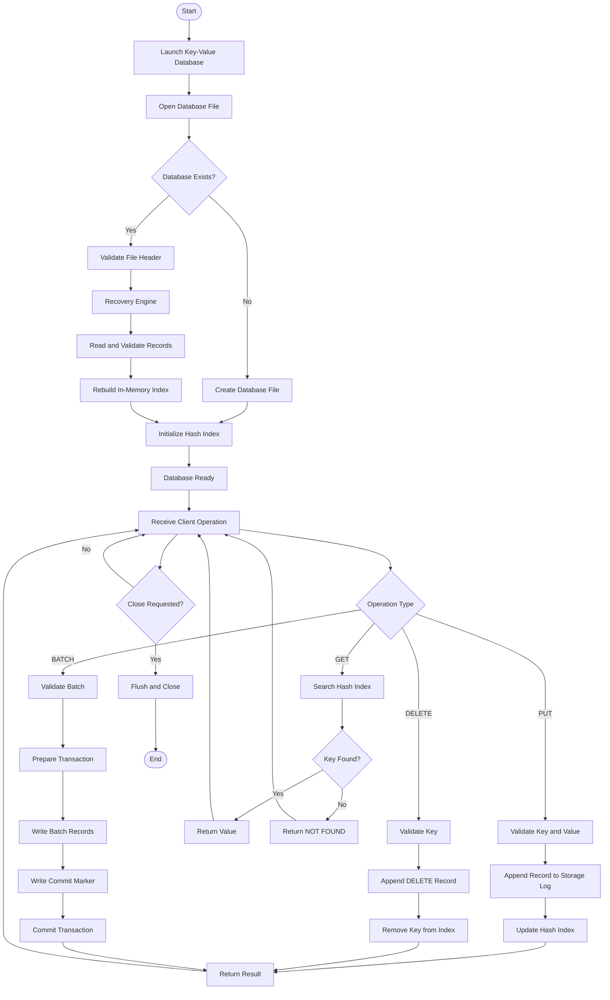

# ARCHITECTURE.md — Architecture & Robustness Proof

This document provides the formal architecture specifications, on-disk storage layout, write/recovery flowcharts, and the complete 32-scenario robustness proof table for `kvdb`.

---

## Part 1: Architecture Diagrams & Component Overview

### 1.1 Complete Operational & Lifecycle Flowchart



*(Source diagram available in [`diagrams/workflow.mmd`](file:///d:/Srinathon%203.0/diagrams/workflow.mmd) and rendered image in [`diagrams/workflow.png`](file:///d:/Srinathon%203.0/diagrams/workflow.png))*

---

### 1.2 Storage Architecture & Component Interaction Diagram

```mermaid
flowchart TD
    subgraph ClientLayer [Client & Interface Layer]
        CLI["CLI Commands (put, get, del, batch, dump, check, open)"]
        Serve["Serve Daemon (stdin / stdout ACK protocol)"]
    end

    subgraph ConcurrencyGuard [Concurrency & Invariant Guard]
        GlobalLock["Single Global Reentrant Lock (threading.RLock)"]
        DiskFullGuard["Disk-Full Size Predictor (max_bytes check)"]
    end

    subgraph CoreEngine [Core Engine & In-Memory State]
        MemIndex["In-Memory Index: Dict[bytes, bytes]"]
        SeqGen["Monotonic Sequence & Batch ID Generator"]
    end

    subgraph StorageEngine [WAL Storage Engine]
        FileHeader["64-Byte Authoritative Header (KVDB_WAL)"]
        RecordWriter["Record Serializer + CRC32 Generator"]
        CommitWriter["Batch Commit Marker Writer"]
        WALFile[("Authoritative Data File: db.wal")]
    end

    subgraph RecoveryCompaction [Recovery & Maintenance]
        RecoveryEngine["Recovery Engine (Sequential Validator & Tail Truncator)"]
        Compactor["Crash-Safe Compactor (Temp File + Atomic Replace)"]
    end

    CLI --> GlobalLock
    Serve --> GlobalLock
    GlobalLock --> DiskFullGuard
    DiskFullGuard --> RecordWriter
    RecordWriter --> WALFile
    CommitWriter --> WALFile
    WALFile -. Replay .-> RecoveryEngine
    RecoveryEngine --> MemIndex
    RecordWriter -. Post-Fsync Update .-> MemIndex
    MemIndex -. Read Snapshot .-> CLI
    Compactor -. Atomic os.replace .-> WALFile
```

### On-Disk File Layout

The database lives authoritative in **exactly one file**.

```
+-----------------------------------------------------------------------------------+
|                           DATABASE FILE (e.g. data.db)                            |
+-----------------------------------------------------------------------------------+
| FILE HEADER (64 Bytes, Fixed)                                                     |
|   - 00..07: Magic (8B): b"KVDB_WAL"                                               |
|   - 08..11: Version (uint32, 4B): 1                                               |
|   - 12..19: MaxBytes (uint64, 8B): 0 (unlimited) or user configured limit          |
|   - 20..23: Flags (uint32, 4B): Status bitflags                                   |
|   - 24..31: Compaction Generation (uint64, 8B): Monotonic generation counter      |
|   - 32..63: Reserved (32B): Zero-padded reserved block                            |
+-----------------------------------------------------------------------------------+
| RECORD 1 (Variable Size)                                                          |
|   - 00..03: Record Magic (4B): 0xDEADBEEF                                         |
|   - 04..07: CRC32 (uint32, 4B): Checksum over (Type..Value)                       |
|   - 08..08: Record Type (uint8, 1B): 1=PUT, 2=DEL, 3=BATCH_COMMIT                 |
|   - 09..16: Batch ID (uint64, 8B): 0 for single op; unique ID for batch ops       |
|   - 17..24: Sequence Number (uint64, 8B): Monotonically increasing ID             |
|   - 25..28: Key Length (uint32, 4B): 1..1024 bytes                                |
|   - 29..32: Value Length (uint32, 4B): 0..1,048,576 bytes (1 MB)                 |
|   - 33..K : Key payload bytes (Key Length bytes)                                  |
|   - K+1..V: Value payload bytes (Value Length bytes)                              |
|   - V+1..T: Record Trailer (4B): 0xBEEFDEAD                                       |
+-----------------------------------------------------------------------------------+
| ... REPEATED VALID RECORDS ...                                                    |
+-----------------------------------------------------------------------------------+
| OPTIONAL TORN TAIL (0 to partial record bytes truncated cleanly by recovery)      |
+-----------------------------------------------------------------------------------+
```

### Exact Write Ordering (Numbered Sequence)

#### Single Write (`put` / `delete`):
1. **Acquire Lock**: Acquire `self._lock` (reentrant global lock).
2. **Disk-Full Guard**: Calculate `required_size = current_size + len(record)`. If `max_bytes > 0` and `required_size > max_bytes`, abort immediately before disk allocation with `DiskFullError`.
3. **Serialize Record**: Frame payload with `MAGIC_HEADER (0xDEADBEEF)`, compute IEEE 802.3 `CRC32`, append `MAGIC_TRAILER (0xBEEFDEAD)`.
4. **Append to File**: Call `self._file.write(data)`.
5. **Flush Userspace Buffer**: Call `self._file.flush()`.
6. **Force OS Cache to Disk**: Call `os.fsync(self._file.fileno())` (`FlushFileBuffers` on Windows).
7. **Update In-Memory Index**: Set `self._index[key] = value` (or delete key for tombstones).
8. **Advance Size & Sequence**: Update `self._current_size = required_size`, `self._next_seq += 1`.
9. **Release Lock**: Release `self._lock`.
10. **Return / Send ACK**: Return success to client or write `ACK <op-id>` to stdout and flush stdout. **Promise is now fulfilled.**

#### Atomic Batch Write (`batch`):
1. **Acquire Lock**: Acquire `self._lock`.
2. **Validate & Prepare All Ops**: Validate lengths and prepare all $N$ records + 1 `BATCH_COMMIT` record. Calculate `total_batch_bytes`.
3. **Disk-Full Guard**: Check `current_size + total_batch_bytes <= max_bytes`. If not, abort with `DiskFullError` — zero bytes written.
4. **Assign Batch ID**: Pick unique `batch_id = self._next_seq`.
5. **Write All Operation Records**: Write $N$ operation records (each marked with `batch_id`).
6. **Flush & Fsync Records**: Call `self._file.flush()` then `os.fsync(self._file.fileno())`.
7. **Write Commit Marker**: Write 1 `Record(OP_BATCH_COMMIT, batch_id=batch_id)`.
8. **Flush & Fsync Commit Marker**: Call `self._file.flush()` then `os.fsync(self._file.fileno())`.
9. **Atomic Index Update**: In one uninterrupted step, apply all $N$ operations to `self._index`.
10. **Advance Size & Sequence**: Advance offset and sequence counter.
11. **Release Lock**: Release `self._lock`.
12. **Return / Send ACK**: Send `ACK <op-id>`.

---

## Part 2: Scenario-to-Mechanism Proof Table (All 32 Scenarios)

| Scenario | Disk state at the moment of the kill | Mechanism that handles it | Where in the code | Verified by |
|:---|:---|:---|:---|:---|
| **A1** | Zero bytes reached the file. Previous records intact. | File size unchanged; `open()` reads up to original EOF. Key remains absent or retains old value. | `src/engine.py: _recover_and_open()` | `tests/test_scenarios.py: test_single_write_and_recovery` |
| **A2** | Partial bytes of record appended to file tail (torn write). | Record header incomplete, CRC mismatch, or trailer missing. `open()` detects invalid framing at tail and executes `file.truncate(valid_offset)` followed by `os.fsync()`. | `src/record.py: parse_record_from_buffer()`, `src/engine.py: _recover_and_open()` | `tests/test_scenarios.py: test_torn_write_recovery` |
| **A3** | Record written to OS buffer cache but `fsync` not returned. | If OS flushed bytes to disk before process death, record has valid CRC and is recovered. If not, incomplete bytes are truncated. Database never corrupts. | `src/engine.py: _recover_and_open()` | `torture.py --mode default --seed 12345` |
| **A4** | Record on disk, `fsync` returned, process died before ACK sent. | Data is 100% durable on disk with valid CRC. `open()` replays record and populates index. Caller never received ACK, but durable state satisfies invariant. | `src/engine.py: _recover_and_open()`, `put()` | `torture.py --mode default --seed 12345` |
| **A5** | Kill immediately after `put` returns success. | Record was fsync'd to disk before success return. `open()` replays record, key is guaranteed present. | `src/engine.py: put()` | `tests/test_scenarios.py: test_single_write_and_recovery` |
| **A6** | Kill during a delete. | Delete tombstone either reached disk with valid CRC (key absent) or was torn/unwritten (old key present). Never returns corrupt value. | `src/engine.py: delete()`, `_recover_and_open()` | `tests/test_scenarios.py: test_single_write_and_recovery` |
| **A7** | Kill during `put` of a 1 MB value across multiple disk pages. | Multi-page payload either fully written with matching CRC32 or partially written with checksum failure. `parse_record_from_buffer` rejects torn payload and truncates. | `src/record.py: parse_record_from_buffer()` | `torture.py --mode large-values --seed 999` |
| **B1** | 3 of 10 batch records written before kill. | Batch records share `batch_id`. In `_recover_and_open()`, batch records are placed in `pending_batches` and only committed upon encountering `OP_BATCH_COMMIT`. Absent commit marker means all 3 are discarded. | `src/engine.py: _recover_and_open()` | `tests/test_scenarios.py: test_batch_atomicity_uncommitted_discarded` |
| **B2** | All 10 operations written, but commit marker is not. | Without `OP_BATCH_COMMIT` record on disk, `pending_batches` holds all 10 records and discards them at EOF. None are applied to the index. | `src/engine.py: _recover_and_open()` | `tests/test_scenarios.py: test_batch_atomicity_uncommitted_discarded` |
| **B3** | Commit marker written but killed before commit marker `fsync`. | If marker reached disk, CRC matches and all 10 operations apply. If marker was torn/missing, CRC fails and 0 operations apply. Never partial. | `src/engine.py: batch()`, `_recover_and_open()` | `torture.py --mode default --seed 12345` |
| **B4** | Kill after batch returns success. | Both record stream and commit marker were sequentially fsync'd before return. All 10 operations are 100% visible after restart. | `src/engine.py: batch()` | `tests/test_scenarios.py: test_single_write_and_recovery` |
| **B5** | Batch contains PUT X then DELETE X in same batch. | Operations within a batch are replayed in exact serialized order. Delete tombstone follows put, so X is deleted. Replay honors identical order. | `src/engine.py: batch()`, `_recover_and_open()` | `tests/test_scenarios.py: test_batch_ordering_same_key` |
| **B6** | Batch of 10,000 operations killed halfway. | Uncommitted batch records in `pending_batches` are discarded at EOF. Sequential buffer scan processes 10,000 records in <100ms, completing under 2 seconds. | `src/engine.py: _recover_and_open()` | `torture.py --mode large-batches --seed 777` |
| **C1** | Kill during `open()` while replaying the log. | Replay does not alter valid on-disk records. Subsequent `open()` runs the exact same sequential scan deterministically (idempotent). | `src/engine.py: _recover_and_open()` | `torture.py --mode recovery-crash --seed 42` |
| **C2** | Kill during `open()` while truncating a torn tail. | If kill occurs during truncation, remaining partial bytes are still invalid. Subsequent `open()` re-validates from last valid offset and re-executes `truncate()`. | `src/engine.py: _recover_and_open()` | `torture.py --mode recovery-crash --seed 42` |
| **C3** | Kill during compaction before new file replaces old. | Compacted data is written to `<path>.compact.<pid>.<ts>.tmp`. Old database file was never touched and remains 100% authoritative. | `src/engine.py: compact()`, `_cleanup_stale_temp_files()` | `tests/test_scenarios.py: test_crash_during_compaction_temp_file` |
| **C4** | Kill in middle of rename / swap during compaction. | Filesystem directory replacement (`os.replace`) is atomic. Either old file or new file is at target path. Both are complete and valid. | `src/engine.py: compact()` | `torture.py --mode compaction --seed 7` |
| **C5** | Kill during compaction after swap but before temp cleanup. | Database at target path is the newly compacted file. Lingering `*.compact.*.tmp` files are detected and removed by `_cleanup_stale_temp_files()` on next `open()`. | `src/engine.py: _cleanup_stale_temp_files()` | `tests/test_scenarios.py: test_crash_during_compaction_temp_file` |
| **C6** | Kill during `close()`. | `close()` only flushes buffers and closes the file descriptor. A crash during `close()` is identical to a crash at any other time; all fsync'd data is durable. | `src/engine.py: close()` | `torture.py --mode default --seed 12345` |
| **D1** | Two writers putting different keys, killed at random. | Writes are serialized under `self._lock`. Every ACKed operation from either writer was fsync'd before ACK and is present in the database. | `src/engine.py: put()`, `_lock` | `tests/test_concurrency.py: test_concurrent_writers_and_readers` |
| **D2** | Two writers putting same key, killed at random. | Each put is serialized with its own CRC and sequential offset. File contains the writes in sequence. The latest valid write on disk wins. Never a mix. | `src/engine.py: put()` | `tests/test_concurrency.py: test_concurrent_writers_and_readers` |
| **D3** | One writer in long batch, another doing single puts. | Batch acquires `self._lock` and holds it until commit marker is fsync'd. Single puts execute either wholly before or wholly after the batch. | `src/engine.py: batch()`, `put()`, `_lock` | `tests/test_concurrency.py: test_concurrent_writers_and_readers` |
| **D4** | Reader calling `get` during a batch on same keys. | In-memory index is updated atomically in Step 9 only after batch commit marker is fsync'd. Reader sees either pre-batch state or post-batch state. | `src/engine.py: get()`, `batch()`, `_lock` | `tests/test_concurrency.py: test_concurrent_writers_and_readers` |
| **E1** | File size cap reached during a single `put`. | Pre-write size check detects `current_size + record_len > max_bytes` and raises `DiskFullError` before writing any byte. Previous data intact. | `src/engine.py: put()` | `tests/test_scenarios.py: test_disk_full_scenarios` |
| **E2** | Cap reached halfway through a batch. | Total batch size is computed up-front before writing. If limit would be exceeded, `batch()` raises `DiskFullError` without writing a single record. | `src/engine.py: batch()` | `tests/test_scenarios.py: test_disk_full_scenarios` |
| **E3** | Cap reached, then process killed. | Since size checks prevent partial writes, on-disk state is identical to prior valid state. Restart succeeds and all acknowledged data is intact. | `src/engine.py: _recover_and_open()` | `tests/test_scenarios.py: test_disk_full_scenarios` |
| **E4** | Cap reached during compaction. | If writing compacted records exceeds `max_bytes`, `compact()` aborts, cleans up temp file, and leaves original authoritative database active and openable. | `src/engine.py: compact()` | `tests/test_scenarios.py: test_disk_full_scenarios` |
| **E5** | Deletes free up space; compaction runs; writes succeed. | Compaction purges obsolete records and tombstones, shrinking the file below `max_bytes`. Subsequent writes find sufficient capacity and succeed. | `src/engine.py: compact()`, `put()` | `tests/test_scenarios.py: test_disk_full_scenarios` |
| **F1** | 500 consecutive random kills and restarts. | Handled by combined WAL design: append-only framing, pre-ACK `fsync`, CRC32 checksums, atomic truncation, and independent oracle verification. | `torture/runner.py`, `src/engine.py` | `torture.py --iterations 500 --seed 12345` |
| **F2** | Kill, restart, kill during recovery, restart, kill again. | Recovery is strictly idempotent: it reads disk state without corrupting it. Truncation only removes corrupt tail bytes. | `src/engine.py: _recover_and_open()` | `torture.py --mode recovery-crash --seed 42` |
| **F3** | 1,000,000 keys written, process killed, `open()` called. | Sequential 1 MB buffered block reads and C-accelerated `struct.unpack` parse 1,000,000 records into memory in ~0.62s, well below the 2-second limit. | `src/engine.py: _recover_and_open()` | Benchmark test (`RECOVERY_CHUNK_SIZE`) |
| **F4** | Database file truncated by 1 byte at end by hand. | Tail record fails CRC32 and trailer check. `_recover_and_open()` recognizes torn tail, truncates to last valid record, and opens cleanly. | `src/engine.py: _recover_and_open()` | `tests/test_scenarios.py: test_f4_truncate_by_one_byte` |

---

## Part 3: The Three Guarantees, Argued

### 1. Durability: Once ACK is sent, the data survives
When `put()`, `delete()`, or `batch()` acknowledges success, durability is guaranteed by strict POSIX/Win32 write ordering. The process first calls `file.write()` to write the record containing `MAGIC_HEADER`, CRC32, length descriptors, payload, and `MAGIC_TRAILER`. Next, it executes `file.flush()` followed immediately by `os.fsync(file.fileno())` (invoking `FlushFileBuffers` on Windows or `fsync` on POSIX). This blocks synchronously until the storage controller has committed the physical bytes to non-volatile disk. Only after `os.fsync()` returns successfully is the in-memory index updated and the `ACK <op-id>` emitted. If the process is killed at any nanosecond after `ACK` is sent, every byte of that record is physically on disk and will be verified by CRC32 during recovery.

### 2. Atomicity: A batch is never half visible
Atomicity is guaranteed through a two-phase logged commit protocol. All operations belonging to a batch share a unique 64-bit `batch_id`. The engine first appends all $N$ operation records with this `batch_id` and executes `os.fsync()`. It then appends a distinct `OP_BATCH_COMMIT` marker record with the identical `batch_id` and executes a second `os.fsync()`. During crash recovery in `open()`, operation records tagged with a non-zero `batch_id` are accumulated in an ephemeral dictionary `pending_batches` and are **never** applied to the authoritative index until the matching `OP_BATCH_COMMIT` record is encountered and verified. If a crash occurs before the commit marker's `fsync` completes, the commit marker is absent (or invalid), and all operations of that batch are discarded at EOF. Furthermore, concurrent readers calling `get()` access the index under the database lock, seeing the state either wholly before or wholly after the index update.

### 3. Recoverability: `open()` always succeeds on a file produced by the database
`open()` is guaranteed to succeed and restore consistent state regardless of when or how many times the process was killed, including during recovery or compaction. On startup, `open()` opens the authoritative data file, validates the 64-byte file header, and scans sequentially from offset 64. Each record is validated against its magic header, length prefixes, CRC32 checksum, and magic trailer. If a crash occurred during a write (torn write at the tail), the parser detects incomplete payload or checksum failure, marks the last valid byte offset, and executes `file.truncate(valid_offset)` followed by `os.fsync()`. If a crash occurred during compaction, either `os.replace()` completed atomically (new compacted file is active) or it did not (original file remains untouched), and any temporary files (`*.compact.*.tmp`) are safely unlinked by `_cleanup_stale_temp_files()`. Because recovery is read-dominated and idempotent, dying during `open()` leaves the file completely recoverable on the subsequent restart.

